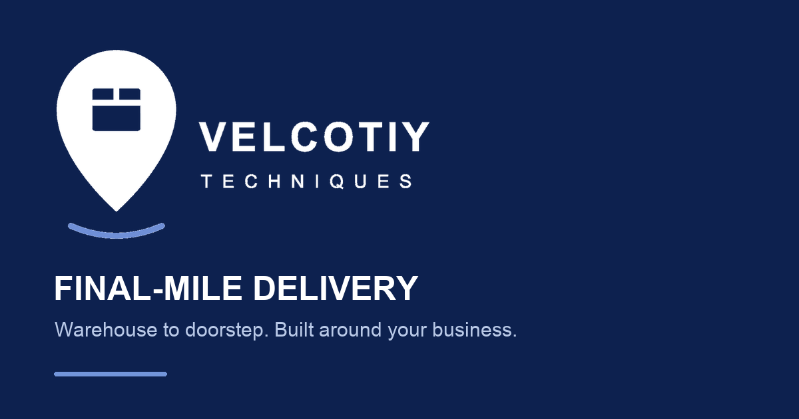

# 3D Motion Logistics Website — React, TypeScript, Vite & GSAP

A premium **motion-driven logistics website** built for **Velcotiy Techniques Inc**, a Canadian final-mile delivery company. The project combines **React 19, TypeScript, Vite, GSAP, React Router, responsive media, technical SEO, AEO, GEO, structured data, and Hostinger deployment**.

**Live website:** https://velcotiytechniques.ca



---

## Overview

This client project was designed and engineered as a modern, high-performance logistics website for a final-mile delivery business.

The website focuses on:

- premium motion and cinematic storytelling
- warehouse-to-doorstep delivery positioning
- responsive mobile-first UX
- service and fleet discovery
- business lead generation
- driver recruitment
- SEO, answer-engine optimization, and AI-readable site structure
- direct-link routing on Hostinger
- production-focused frontend performance

The project uses a lightweight frontend with a small PHP endpoint for driver application email. Contact and quote requests use email drafts.

---

## Core Features

- Motion-led homepage with warehouse-to-doorstep storytelling
- React 19 + TypeScript + Vite architecture
- GSAP-powered scrolling, reveals, transitions, and motion effects
- Responsive design for desktop, tablet, and mobile
- Final-mile delivery service pages
- Same-day delivery positioning
- Warehouse-to-doorstep delivery workflows
- Delivery operations management content
- Dedicated fleet and EV delivery sections
- Responsive fleet image presentation
- Canadian delivery coverage visualization
- Business / warehouse solutions page
- Driver application form with validation
- Direct driver application email through a PHP endpoint
- Multi-step quote request form
- Contact form with email-draft workflow
- Careers page
- Mobile menu with scroll locking and scroll-position restoration
- React Router clean URLs
- Hostinger SPA fallback via `.htaccess`
- Custom 404 page
- SEO metadata and canonical URLs
- Open Graph + social sharing metadata
- JSON-LD structured data
- XML sitemap
- `robots.txt`
- `llms.txt`
- Performance-focused route and asset prefetching

---

## Tech Stack

| Category | Technology |
|---|---|
| Frontend | React 19 |
| Language | TypeScript |
| Build Tool | Vite 7 |
| Routing | React Router |
| Motion | GSAP |
| Forms | React Hook Form |
| Validation | Zod |
| Icons | Lucide React |
| Hosting | Hostinger |
| SEO | Metadata, canonical URLs, JSON-LD, sitemap, robots.txt, llms.txt |

---

## Public Routes

```text
/
/services
/fleet
/coverage
/about
/carriers
/drivers
/careers
/contact
/quote
```

Unknown application routes render the project's custom React 404 page.

---

## Motion & Visual Experience

The site was built around a premium visual narrative rather than a generic static corporate template.

Motion patterns include:

- cinematic hero movement
- scroll-triggered reveals
- warehouse-to-city storytelling
- route and operational visualization
- fleet transitions
- staged section entrances
- reduced-motion support
- responsive behavior across smaller devices

The original design direction explored 3D-style interaction, but the production implementation prioritizes **smooth motion, visual depth, responsive media, and performance** instead of unnecessary heavy WebGL rendering.

---

## Logistics & Final-Mile Delivery UX

The website communicates services including:

- Final-Mile Delivery
- Same-Day Delivery
- Warehouse-to-Doorstep Delivery
- Distribution
- Delivery Operations Management
- Driver Management
- Driver Recruitment & Onboarding Support
- Dedicated Delivery Operations
- Dedicated Fleet
- EV Delivery

The customer journey is presented around:

**Warehouse pickup → parcel handoff → driver dispatch → city route → doorstep delivery**

---

## Driver Application Flow

The driver form collects:

- full name
- email
- phone
- age
- city
- province
- legal authorization to work in Canada
- valid driver's licence status
- vehicle type
- vehicle name
- weekly availability
- delivery experience
- emergency contact
- additional notes

After validation, the website posts the application to `/api/driver-application.php`. The endpoint validates it and sends an email to `info@velcotiytechniques.ca` through SMTP. The site shows success only after the SMTP server accepts the message.

No driver application data is intentionally stored by this website.

---

## Contact & Quote Workflows

The website uses lightweight client-side workflows:

### Contact form

The visitor completes the form and the site opens a pre-filled email draft for review and sending.

### Quote form

The visitor completes a multi-step quote request, reviews the entered information, and opens an email draft containing the structured request.

This avoids unnecessary backend infrastructure for simple business inquiries.

---

## SEO, AEO & GEO

The project includes a production-focused search and answer-engine foundation.

Implemented features include:

- unique page titles
- unique meta descriptions
- canonical URLs
- Open Graph metadata
- Twitter / X card metadata
- Organization schema
- WebSite schema
- Service schema
- BreadcrumbList schema
- XML sitemap
- `robots.txt`
- `llms.txt`
- crawlable internal links
- semantic headings
- descriptive image alt text
- service-specific landing content
- location-aware delivery copy
- structured business information

### Search concepts covered

The site naturally targets topics such as:

- final-mile delivery
- last-mile delivery
- same-day delivery
- warehouse-to-doorstep delivery
- Canadian logistics
- logistics company website
- delivery operations management
- dedicated fleet
- EV delivery
- warehouse delivery
- business delivery solutions
- driver management
- logistics web design
- logistics website development

---

## Performance Engineering

The site was optimized to retain a premium visual experience without unnecessary rendering cost.

Performance decisions include:

- responsive images
- lightweight SVG coverage visualization
- reduced use of expensive 3D/WebGL
- route and asset prefetching
- critical image preloading
- lazy loading for non-critical media
- Vite production bundling
- reduced-motion support
- removal of missing/unused media references
- lightweight frontend with a small PHP mail endpoint

---

## Hostinger SPA Routing

The project uses React Router with clean URLs.

For static Hostinger / Apache hosting, the repository contains:

```text
public/.htaccess
```

Vite copies this file into:

```text
dist/.htaccess
```

The rule preserves real files and directories, then internally serves `index.html` for React routes.

This allows direct links such as:

```text
https://velcotiytechniques.ca/drivers
https://velcotiytechniques.ca/careers
https://velcotiytechniques.ca/services
```

to work when:

- opened directly
- refreshed
- shared
- accessed from search engines

---

## Local Development

Install dependencies:

```bash
npm install
```

Start the development server:

```bash
npm run dev
```

Run production checks:

```bash
npm run build
npm run lint
npx tsc --noEmit --skipLibCheck false
npm run preview
```

---

## Production Deployment

Build the application:

```bash
npm run build
```

Deploy the **contents of `dist/`** to the Hostinger site root.

Make sure the hidden file below is included:

```text
.htaccess
```

After deployment, verify:

```text
/
/services
/fleet
/coverage
/drivers
/careers
/contact
/quote
/robots.txt
/sitemap.xml
/llms.txt
```

Direct route refreshes should load the React application rather than a Hostinger 404 page.

---

## Project Structure

```text
src/
├── components/
│   ├── common/
│   ├── forms/
│   └── layout/
├── config/
├── data/
├── lib/
├── pages/
├── sections/
└── styles/

public/
├── brand/
├── media/
├── .htaccess
├── robots.txt
├── sitemap.xml
└── llms.txt
```

---

## Main Editing Locations

| Content | File |
|---|---|
| Business configuration | `src/config/siteConfig.ts` |
| Homepage sections | `src/sections/home/HomeSections.tsx` |
| Internal pages | `src/pages/ContentPages.tsx` |
| Services | `src/data/services.ts` |
| Fleet | `src/data/fleet.ts` |
| Coverage | `src/data/coverage.ts` |
| Forms | `src/components/forms/InquiryForm.tsx` |
| Submission helpers | `src/lib/submissions.ts` |
| SEO & structured data | `src/components/common/SEO.tsx` |
| Responsive styles | `src/styles/` |

---

## Security & Privacy

This repository contains public-facing frontend code for a client business website.

- SMTP credentials are required server-side for driver application email and must never be exposed in frontend code.
- No backend database is used for public forms.
- Local environment files are ignored by Git.
- `node_modules/`, `dist/`, logs, and OS metadata are excluded from Git.
- Public business contact information may exist in frontend source because it is intentionally displayed on the public website.
- Contact and quote form data is not stored by the application.
- Driver application data is processed by the PHP endpoint and sent by email; this website does not intentionally persist it.
- Secrets, passwords, access tokens, private keys, and credentials should never be committed to this repository.

---

## Quality Checks

The project is maintained with:

```bash
npm run build
npm run lint
npx tsc --noEmit --skipLibCheck false
```

The website is also manually tested for:

- desktop responsiveness
- mobile responsiveness
- direct route loading
- navigation
- forms
- driver application submission and failure state
- quote flow
- SPA routing
- 404 handling
- SEO files
- media loading

---

## GitHub Search Keywords

React logistics website · GSAP website · motion website · animated website · 3D motion website · final-mile delivery website · last-mile delivery website · React TypeScript website · Vite client project · logistics web design · Canadian logistics website · responsive business website · SEO optimized React website · AEO website · GEO website · Hostinger React deployment · React Router SPA · modern logistics website · delivery company website · frontend portfolio project

---

## Repository Topics

Recommended GitHub topics for this project:

```text
react
typescript
vite
gsap
react-router
motion-design
animated-website
3d-website
logistics
logistics-website
final-mile-delivery
last-mile-delivery
responsive-web-design
frontend
web-development
seo
aeo
geo
hostinger
client-project
business-website
```

---

## Client Project

This project was developed for **Velcotiy Techniques Inc** as a production business website and frontend portfolio project.

**Website:** https://velcotiytechniques.ca

---

## License / Usage

This repository is publicly viewable for portfolio and engineering-reference purposes.

The Velcotiy Techniques Inc brand, logo, generated visuals, business content, and proprietary assets are not automatically licensed for reuse.

---

## Driver application email on Hostinger

The driver form posts JSON to `/api/driver-application.php` on the same origin. Deploy the contents of `dist/`, including `api/driver-application.php` and `.htaccess`, to a PHP 8.1+ enabled Hostinger `public_html`. The SPA fallback continues to serve `/drivers`; the physical PHP file handles the API request.

The endpoint first reads `SMTP_HOST`, `SMTP_PORT`, `SMTP_ENCRYPTION`, `SMTP_USER`, `SMTP_PASS`, `SMTP_FROM`, and `DRIVER_APPLICATION_TO` from PHP's server environment. If required values are missing, it fills them from a private PHP config file. `SMTP_ENCRYPTION` is optional in the environment: port 465 defaults to `ssl`, other ports to `tls`. The SMTP username is the **full mailbox address**, and the password is the **mailbox password**. The recipient must be `info@velcotiytechniques.ca`. Credentials must remain outside Git and the public web root; never use `VITE_*` variables for them.

The default private config location is `../private/mail-config.php` relative to PHP's `DOCUMENT_ROOT`. For example, if the document root is `/home/USERNAME/domains/velcotiytechniques.ca/public_html`, create `/home/USERNAME/domains/velcotiytechniques.ca/private/mail-config.php`. Copy the structure from `server/mail-config.example.php` and enter the real mailbox details **only in the private Hostinger file**. If you instead keep the private file at `/home/USERNAME/private/mail-config.php`, set the server-side `MAIL_CONFIG_PATH` environment variable to that absolute path. The endpoint resolves and rejects any config path inside the public web root. The example file is not deployed by Vite.

Hostinger SMTP settings: `smtp.hostinger.com` with port **465** and `ssl`, or port **587** and `tls` (STARTTLS). The endpoint uses authenticated SMTP and sets Reply-To to the applicant's email. It returns success only after the SMTP server accepts the message; final inbox delivery should be checked separately. Contact and quote still open email drafts, and general WhatsApp links remain unchanged.

To check the live deployment, open `/api/driver-application.php` in a browser: `{"sent":false}` with HTTP 405 confirms the endpoint exists, but does **not** test SMTP. Then submit one valid application from `/drivers` and confirm that it reaches `info@velcotiytechniques.ca` (check spam/junk too). A failed send keeps the form data; review Hostinger's PHP error log for the safe `driver-mail` category. Do not put a real password in a test request or browser console. When PHP CLI is available, run `php server/tests/driver-mail.php` for the local config and validation checks; the test uses placeholder credentials and sends no email.
